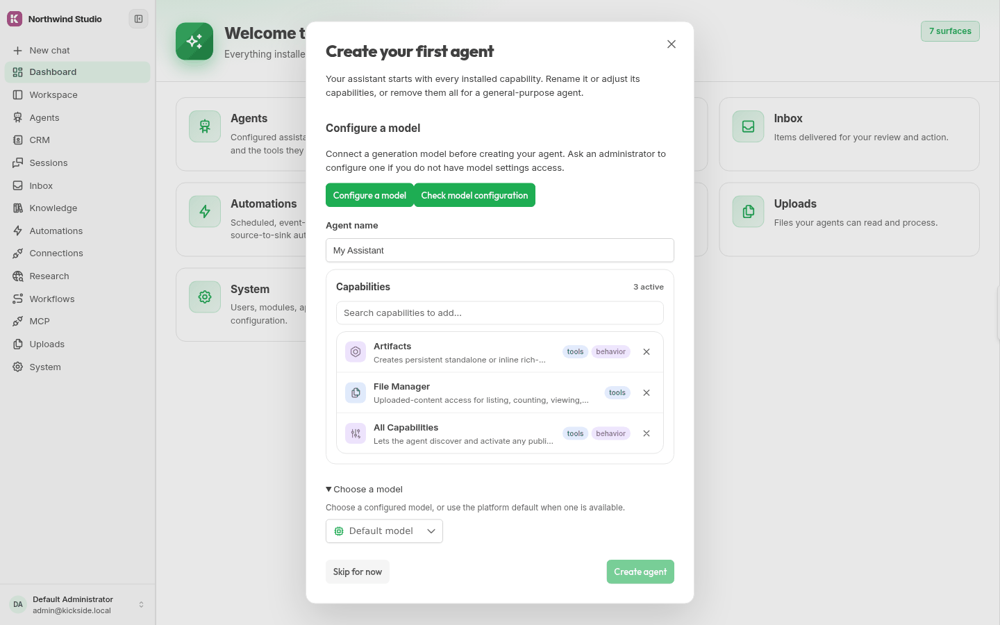

# Create your first agent

An administrator configures a provider and model before a member creates an agent. In **System → Models**, the administrator adds the provider profile, supplies its credentials, refreshes its model list, and assigns a model to at least the `fast` class, which new agents use by default.

When a new member has no personal agent, `agent-onboarding` displays the **Create your first agent** prompt. It starts with **All Capabilities**, **Artifacts**, and **File Manager** selected. **All Capabilities** lets the agent discover installed tools; the member can adjust the defaults or remove them for a general-purpose agent.

1. Keep the default name **My Assistant** or enter another.
2. Review **All Capabilities**, **Artifacts**, and **File Manager**, then adjust them for the task.
3. **Choose a model** is optional when the `fast` class has a model. Otherwise select a model, or use **Configure a model** to open the model settings.
4. Choose **Create agent**. The prompt creates the personal agent and opens its chat.
5. Send a short paragraph and check its response.

If the run fails, check the provider credentials and model assignment in Models. A capability that reads a knowledge base or connection also needs access to that resource. A member can select **Skip for now** and return to create an agent later.

See [agents](../using/agents.md) for capability and routing settings, and [chat](../using/chat-and-artifacts.md) for returning to a conversation.
