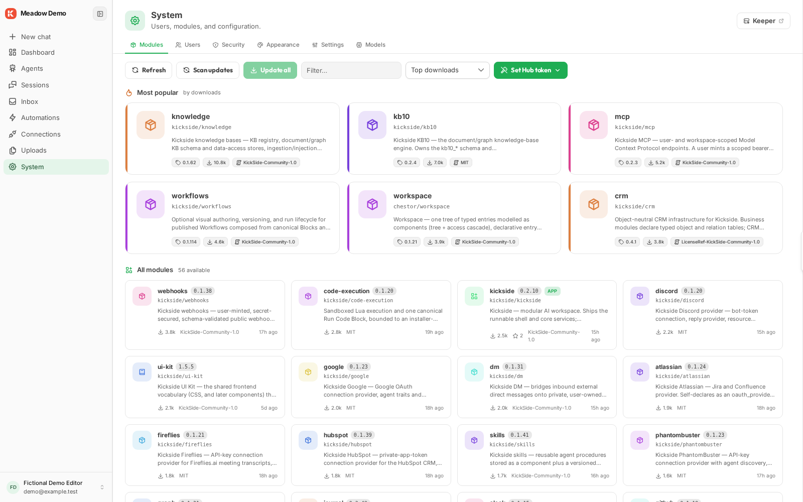

# Install a module

An administrator installs packages from **System → Modules**.

1. Open the Hub catalog and find a package by its Hub ID, such as `kickside/crm`.
2. Open the install plan and review its dependencies.
3. Supply any required host resources and security bindings.
4. Apply the plan and wait for installation and migrations to finish.
5. Open the feature it contributes. A package can supply tools, converters, or backend services without adding a navigation item.

The [module catalog](../reference/modules.md) lists the public package set. Read a package's requirements before installing it: research needs model and search configuration; CRM starts with an empty business schema.

Check the installed package graph and the feature itself after installation. Use **System → Modules → Update all**, review the plan, apply it, and restart from the same installation directory. Module migrations update existing data as part of the Hub update; no separate data-conversion step is required.
