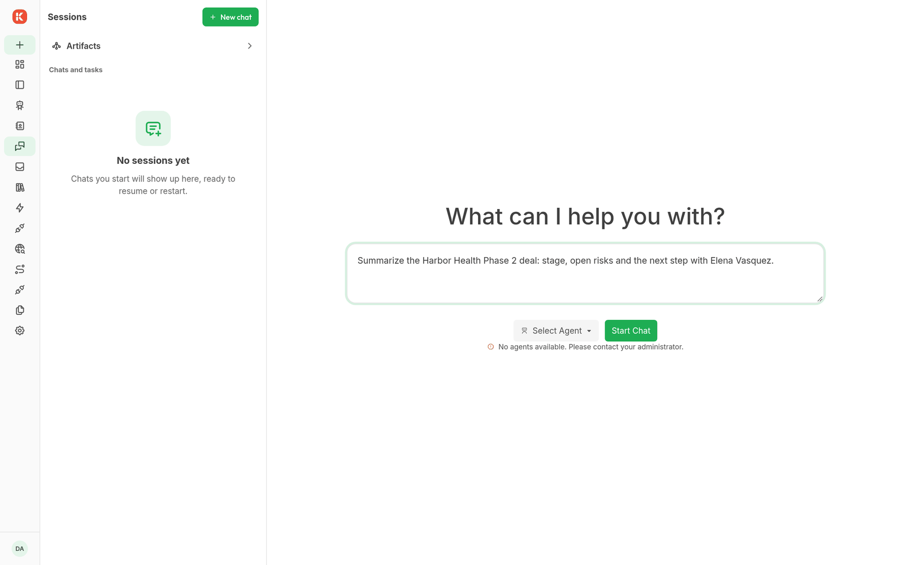

# Chat and artifacts

Choose **New chat**, select an agent, and send a message. The agent uses its configured model and capabilities. Open **Sessions** to return to a saved conversation.

Use the chat attachment control to supply files. File processing depends on the installed upload processors and converters; inspect a failed upload in **Uploads** before retrying it.

An agent with the artifact capability can create supported artifacts. The installed component and renderer catalog determines the available types. Ask for the result you need and give the agent access to its source resources.

Open the **Artifacts** gallery to view an artifact and its originating session. If an artifact fails to open, check access to its resource and whether the owning renderer is installed.

See [agents](agents.md), [uploads](uploads.md), and [knowledge](knowledge.md).
