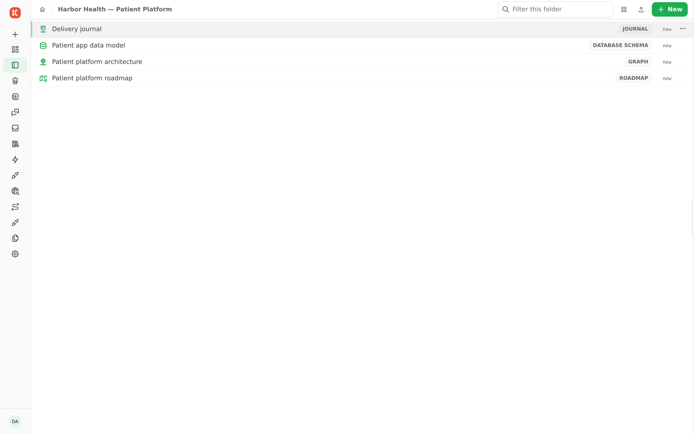
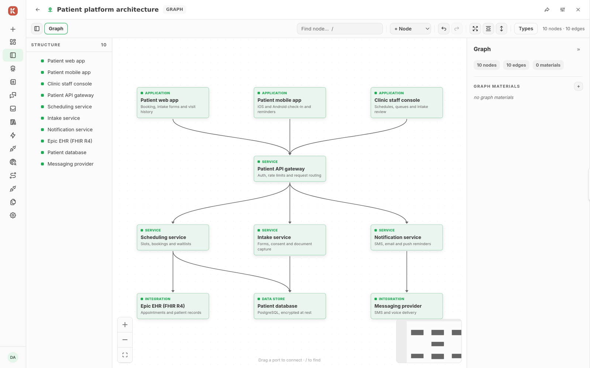
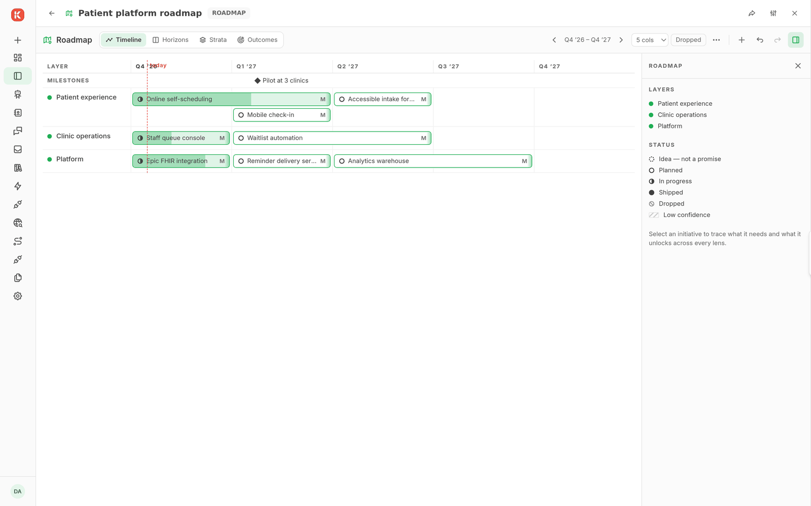
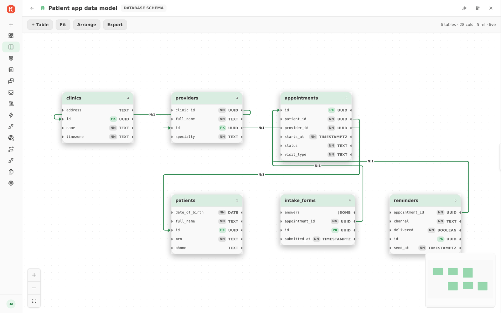
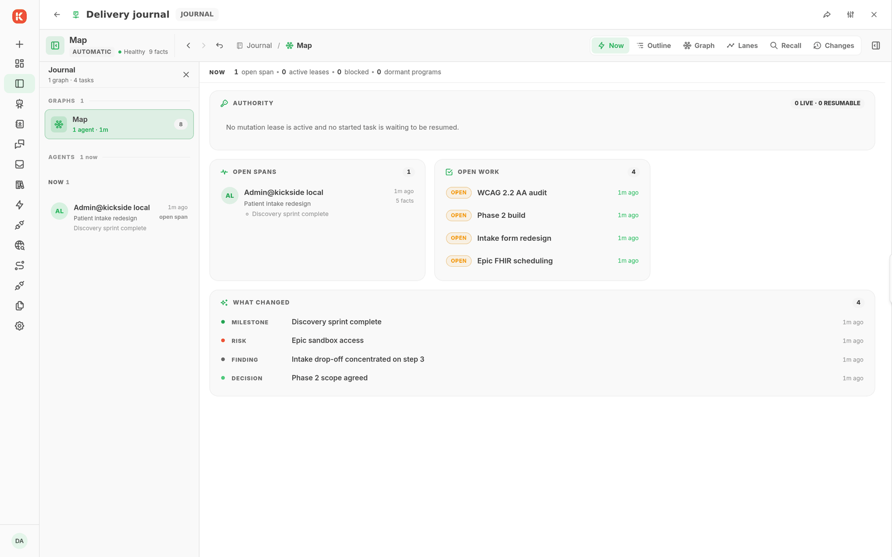

# Chestor

Install `chestor/workspace` and the component kinds you need. The Workspace displays typed entries in a tree; each kind owns its data and renderer.

| Kind | Use |
| --- | --- |
| Workspace | Organize entries and open their views |
| Graph | Edit nested semantic graphs, nodes, edges, materials, and layout |
| Journal | Inspect agent memory, events, work hierarchy, proof, and recall |
| Roadmap | Plan initiatives, outcomes, dependencies, milestones, and periods |
| DB Schema | Describe tables, columns, relations, indexes, and diagram layout |

Open Workspace and use its create control to select an installed kind. Enter the requested configuration, then open the entry. A kind needs a declared creation view to appear in the picker. Sharing and inherited access govern the tree.

Workspace placement does not transfer ownership of a backing resource. Removing a file entry removes its pointer; removing a folder removes descendant workspace entries. Pinned, provisioned, and system entries reject deletion.

DB Schema describes a schema; it does not provision an application database. Journal integration follows its configured graph and agent tools.

The [Chestor repository](https://github.com/kicksideai/chestor) owns the domain modules.

