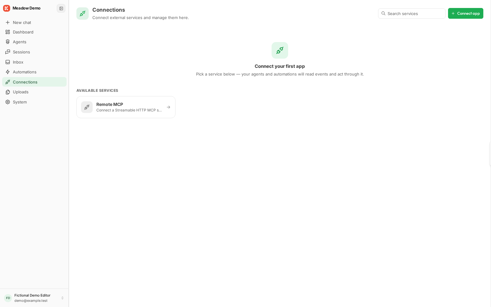
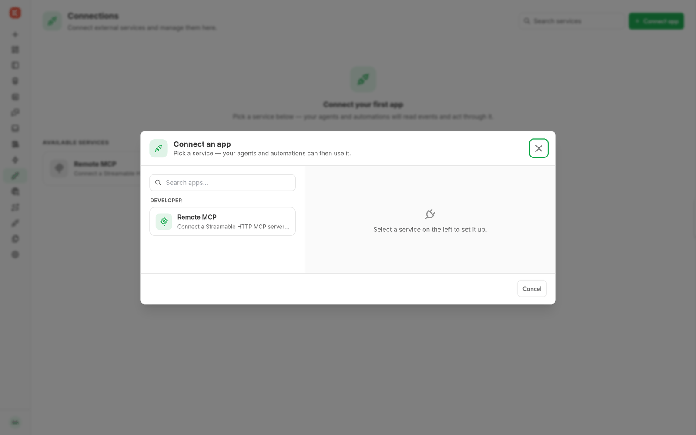

# Connections

Open **Connections** to inspect connected accounts or choose **Connect app** to authorize another one. Each installed provider supplies its setup fields and supported operations.

A connection card provides status and available actions. Share it with the users or groups that need the resource. Use its renewal or reconnect action when authorization expires; remove it when the account is no longer needed.

Select the authorized connection in the capability or automation that uses it. Connection permissions remain required during execution. Installing a provider alone does not create an account connection.

Model provider profiles live in **System → Models**. The `kickside/mcp-client` provider connects to an external MCP server; [MCP credentials](mcp.md) expose KickSide to an external client.

The Remote MCP connector appears as an available service after its module is installed.

