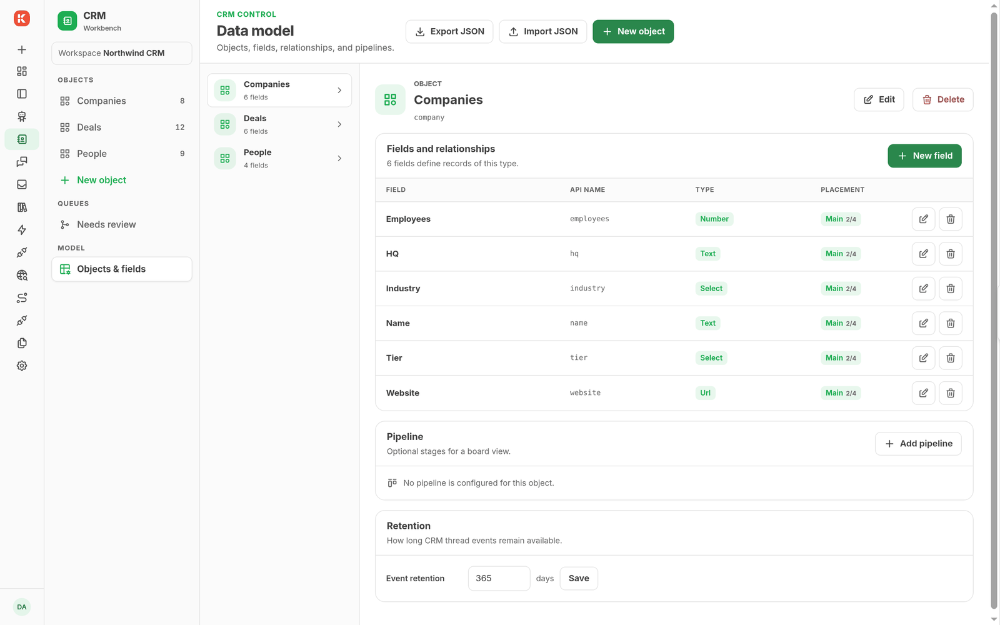
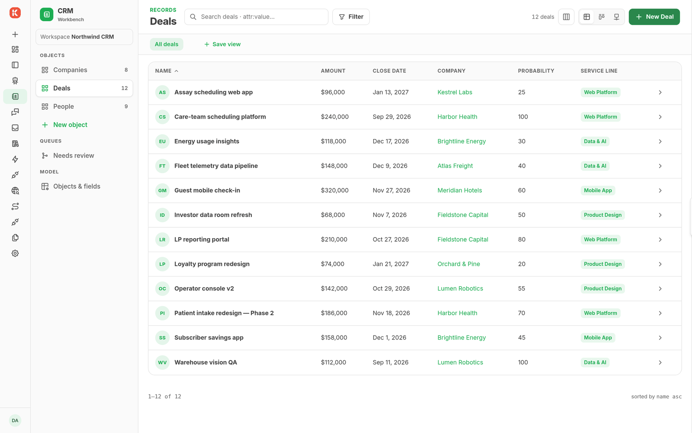
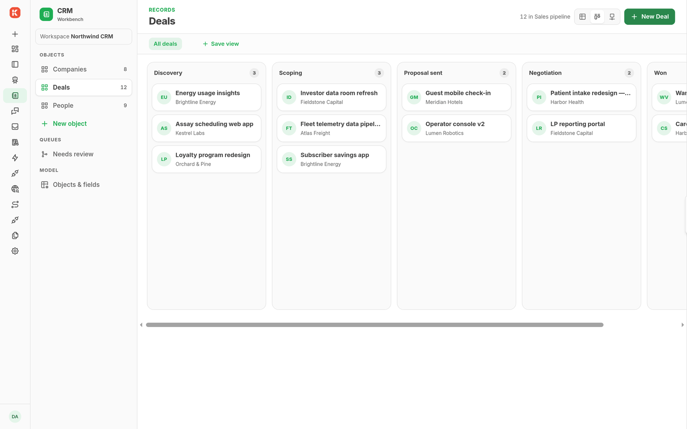
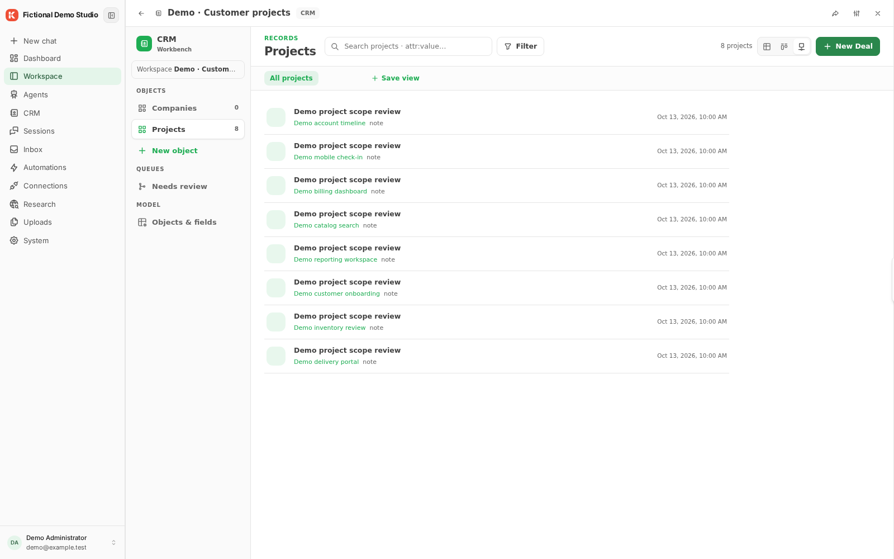

# CRM

CRM provides typed records, relations, search, and schema editing. A fresh CRM has an empty schema: it does not supply a company, contact, or opportunity schema by itself.

The screenshots show a fictional sales schema with companies, people, and deals configured for a demonstration workspace.

## Configure records

Install `kickside/crm` from **System → Modules**, open **CRM**, and choose **Create CRM**. Then install a business module that declares the objects you need, or have an administrator define them in **Objects & fields**. The schema defines objects, fields, types, relations, and views. **Import JSON** and **Export JSON** in that editor move a schema, not records.

 Review consuming modules before changing a shared field.

Open a configured object, create a record with its required fields, and save it. Open the saved record to inspect its fields, related records, and timeline. Available tables or boards follow the declared views.

## Import and synchronize

Bring records in through a Data Sync Automation with a CRM destination, CRM agent tools, or another module that writes through CRM's writable contract. Check the import or Automation outcome and the resulting record; a source event alone does not prove a destination write.

CRM contributes agent tools and Blocks for record operations, alias resolution, and merge review. A merge review can wait for a human decision through a durable Flow.

See the [CRM module contracts](https://github.com/kicksideai/crm/blob/main/docs/module.md) and [field configuration](https://github.com/kicksideai/crm/blob/main/docs/field-config.md).
