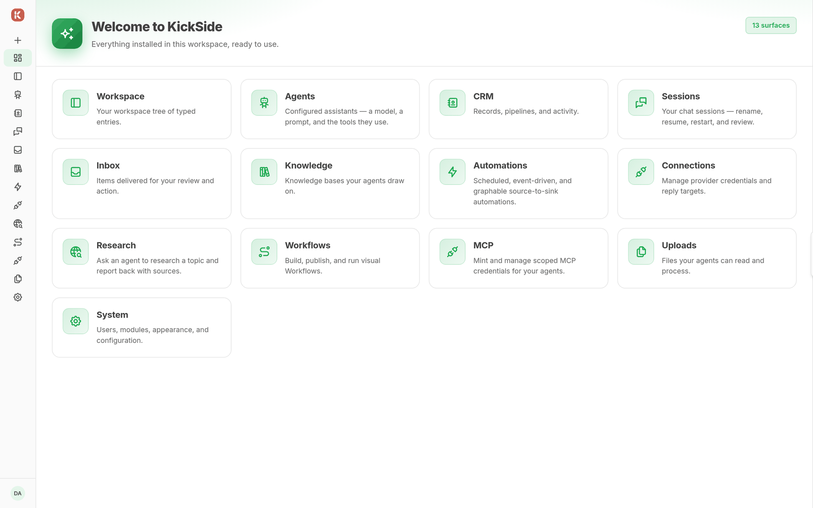

# Dashboard

The `kickside/dashboard` module ships with KickSide and lists installed navigable surfaces. Each card shows a name, description, and icon.

Open **Dashboard** and select a card to open the feature.

 The card set follows installed navigation and view declarations.

If a card is missing, check that its module is installed, declares navigation and a view, and is visible to your user. Domain metrics belong to the modules that provide them.

See [module installation](../getting-started/first-module.md).
