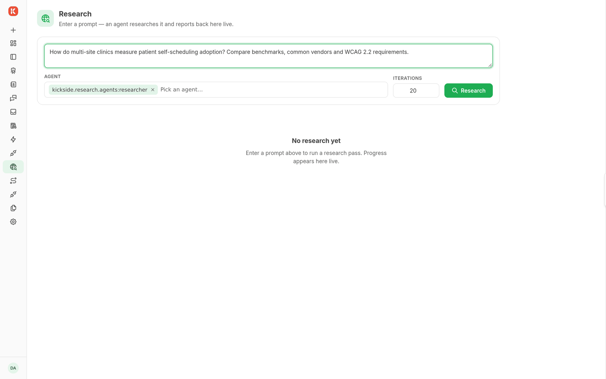

# Research

The optional `kickside/research` module supplies a research page, agent, run history, and Research Block.

The screenshot shows the question form before a run starts. Reports appear after a run completes.

1. Install the module and configure its model and search providers.
2. Open Research and submit a question.
3. Follow the run's state and inspect its result or failure.
4. Return to run history to reopen an earlier result.

The Research Block uses the same request lifecycle and waits for a terminal result. The native research page works without the visual Workflow editor.

The **Web Research** setup bundle supplies search capabilities. Inspect its package list when you also need the research page. See the [research module](https://github.com/kicksideai/components/tree/main/research) for its requirements.
